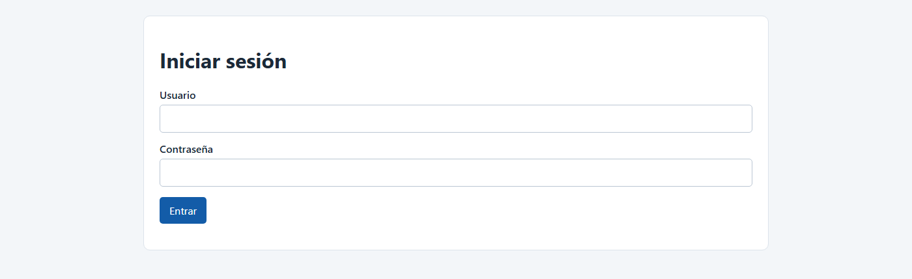
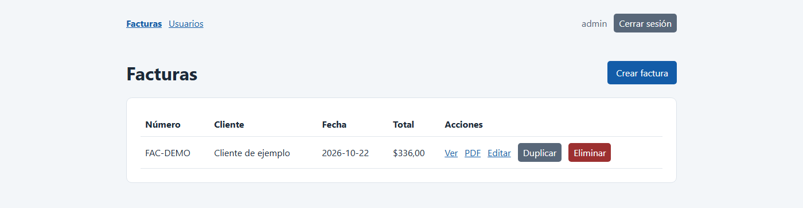
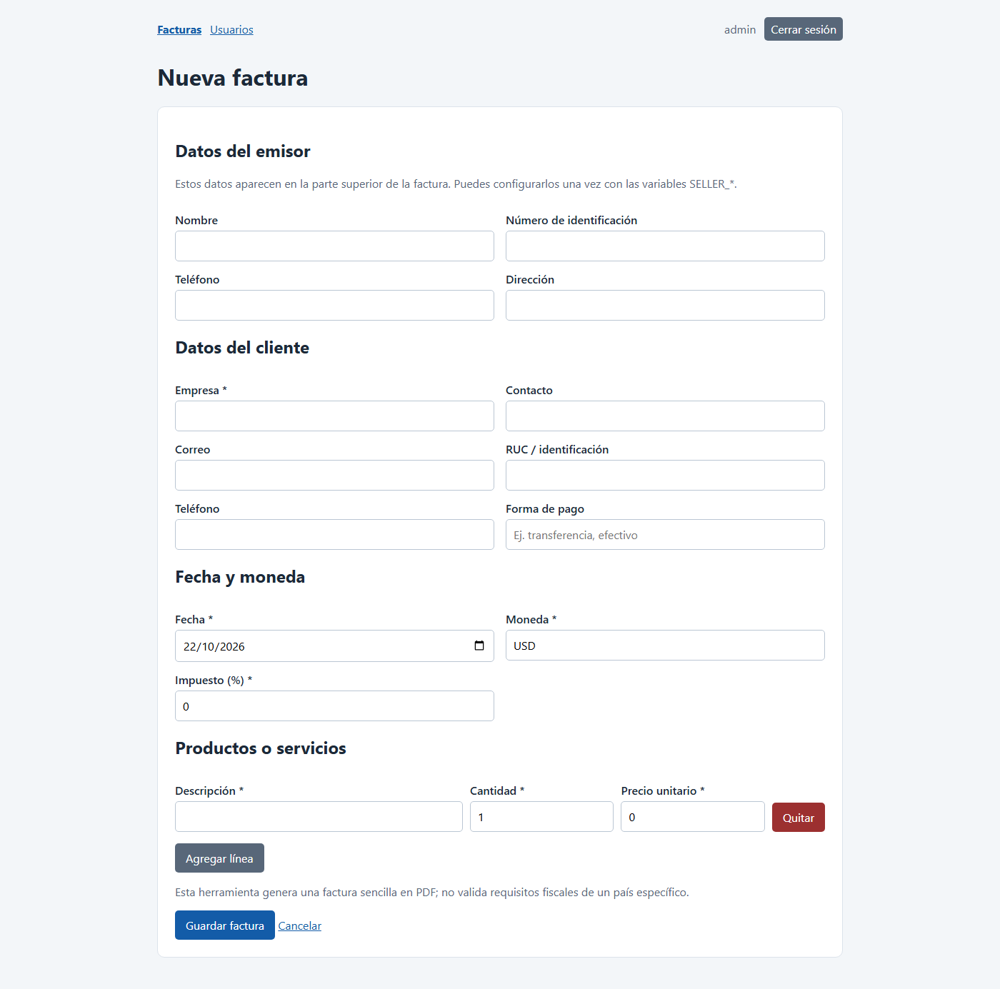
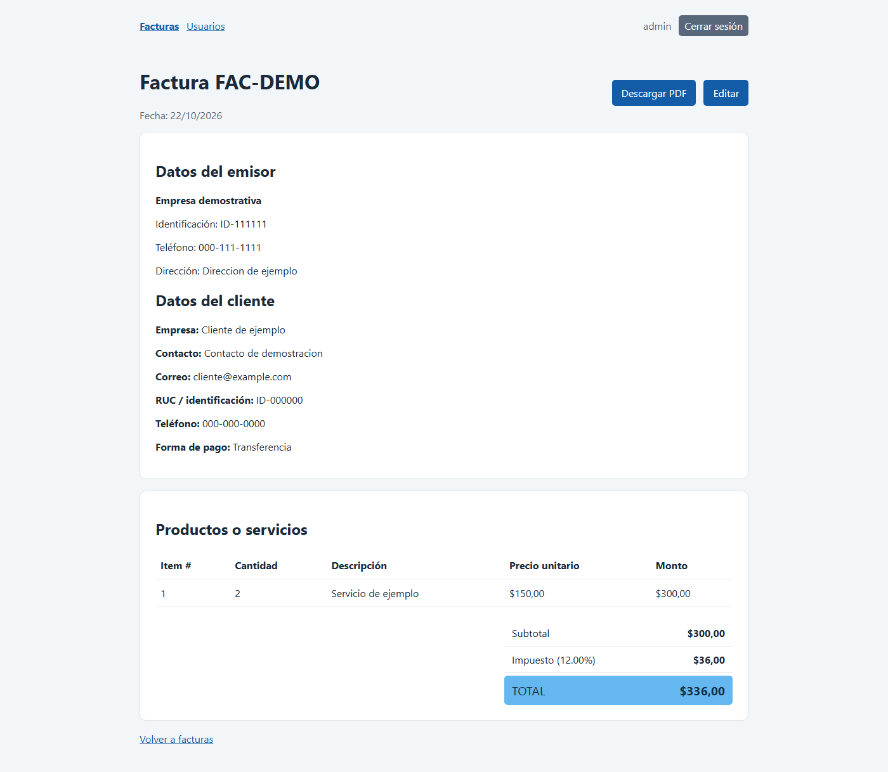
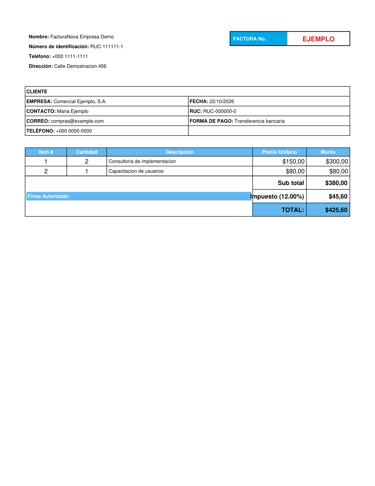
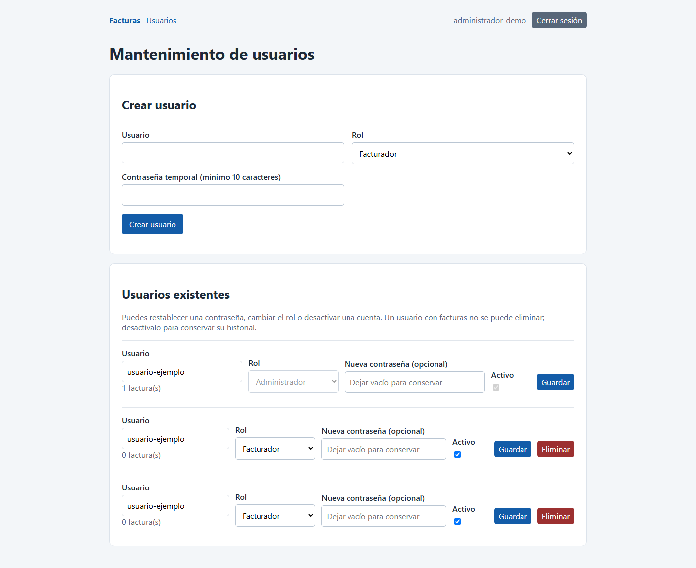

# Guía de usuario de FacturaNova

Esta guía explica cómo iniciar sesión, crear y administrar facturas y, para administradores, mantener las cuentas de usuario.

> Las capturas usan datos de ejemplo. No contienen información real de clientes ni contraseñas.

## 1. Iniciar sesión

Abre la dirección web que te proporcionó quien administra FacturaNova. En una instalación local suele ser `http://127.0.0.1:5000`. Ingresa el nombre de usuario y la contraseña que te asignaron.

Tu rol determina lo que puedes hacer:

| Rol | Acceso |
| --- | --- |
| Facturador | Puede crear y administrar sus propias facturas. |
| Administrador | Puede ver todas las facturas y administrar las cuentas desde **Usuarios**. |

## 2. Consultar la lista de facturas

Al ingresar, se muestra la lista de facturas disponibles para tu cuenta. Selecciona **Crear factura** para comenzar una nueva.

En cada factura aparecen estas acciones:

- **Ver**: consultar el detalle y los totales.
- **PDF**: abrir o descargar el documento PDF.
- **Editar**: modificar una factura existente y guardar los cambios.
- **Duplicar**: crear una copia para usar como punto de partida. Revisa y guarda los datos de la copia antes de usarla.
- **Eliminar**: borrar la factura después de confirmar. Esta acción no se puede deshacer.

Los facturadores solo ven las facturas que ellos crearon. Los administradores pueden consultar todas.

## 3. Crear una factura

Completa el formulario **Nueva factura**:

1. **Datos del emisor**: indica el nombre, identificación, teléfono y dirección. Si ya aparecen llenos, revísalos.
2. **Datos del cliente**: escribe la empresa del cliente; es obligatorio. Contacto, correo, identificación, teléfono y forma de pago son opcionales.
3. **Fecha y moneda**: selecciona la fecha, escribe un código de moneda de tres letras (por ejemplo, `USD`) y el porcentaje de impuesto entre 0 y 100.
4. **Productos o servicios**: por cada línea, agrega una descripción, cantidad mayor que cero y precio unitario igual o mayor que cero. Usa **Agregar línea** para añadir más productos o servicios; **Quitar** elimina una línea adicional.
5. Selecciona **Guardar factura**. Si falta un dato o un valor no es válido, corrígelo y vuelve a guardar.

El sistema calcula el subtotal, el impuesto y el total usando las cantidades y precios ingresados.
El PDF final muestra únicamente las líneas con productos o servicios; no agrega filas vacías de relleno.

## 4. Revisar, editar o descargar el PDF

Desde la lista, selecciona **Ver** para revisar los datos del emisor y del cliente, las líneas y los totales. En el detalle puedes seleccionar **Descargar PDF** o **Editar**.

### Así queda la factura final

Esta es una vista previa de la factura en PDF, tal como se genera al seleccionar **Descargar PDF**. El ejemplo contiene información e importes ficticios.

También puedes [abrir o descargar el PDF de ejemplo](docs/ejemplo-factura.pdf).

Antes de compartir el PDF, revisa que los datos del cliente, la moneda, la fecha, el impuesto y los importes sean correctos. La aplicación genera un PDF sencillo; no certifica el cumplimiento de requisitos fiscales ni sustituye un sistema de facturación electrónica.

## 5. Administrar usuarios (solo administradores)

Selecciona **Usuarios** en la barra superior para abrir el mantenimiento de cuentas.

### Crear una cuenta

1. En **Crear usuario**, escribe un nombre de entre 3 y 64 caracteres. Se permiten letras, números, punto, guion y guion bajo.
2. Selecciona el rol **Facturador** o **Administrador**.
3. Define una contraseña temporal de al menos 10 caracteres y selecciona **Crear usuario**.
4. Comunica las credenciales al usuario de forma segura; no las publiques ni las incluyas en documentos compartidos.

No existe registro público: un administrador debe crear las cuentas.

### Cambiar una cuenta existente

- Edita el nombre o el rol y selecciona **Guardar** para aplicar los cambios.
- Para restablecer la contraseña, escribe una nueva de al menos 10 caracteres en **Nueva contraseña** antes de guardar. Deja ese campo vacío para conservar la contraseña actual.
- Desmarca **Activo** y guarda para deshabilitar la cuenta. Es preferible desactivarla si tiene facturas, así se conserva el historial.
- **Eliminar** solo está disponible para cuentas sin facturas y no permite eliminar la cuenta con la que se inició sesión.

El sistema evita desactivar o quitar el rol de administrador a la última cuenta de administrador activa. El administrador tampoco puede quitarse ese rol ni desactivar su propia cuenta desde el mantenimiento.

## 6. Cerrar sesión

Selecciona **Cerrar sesión** al terminar, especialmente si compartes el dispositivo. Para volver a entrar, usa tus credenciales asignadas.
